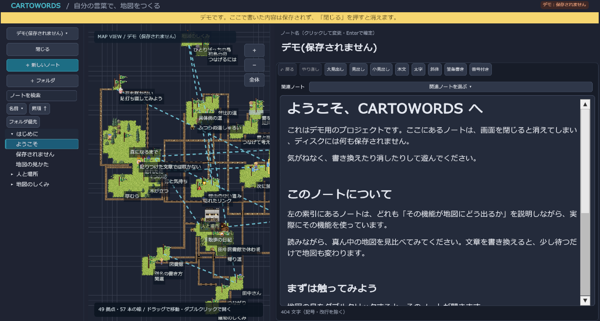
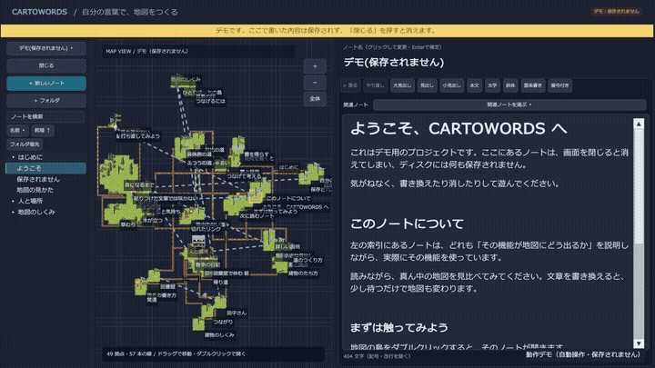

# Cartowords

[▶ 動作デモを見る（MP4・約34秒）](./Docs/Media/cartowords-demo.mp4)

> 答えを得る時代に、自分の考えを育てる。自分の言葉だけで書く、AI を内蔵しないテキストエディタ。書いた言葉が町になり、地図になる。

## 製品概要

### 背景(製品開発のきっかけ、課題等)

AI から手軽に答えを得られる今、私たちは「自分はどう思うのか」を言葉にする機会が少なくなりました。得られた答えは便利である一方、そのまま受け取ってしまうと、自分の思いや疑問と向き合って判断する過程が抜け落ちてしまいます。AI の答えには誤りが含まれることもあり、自分の考えを持って判断し、行動することがますます大切になっています。人生経験の少ない若者ほど、その影響を強く受けてしまうのではないでしょうか。私たちはこのことを深く憂慮し、新しいテキストエディタを構想しました。

ノートに他所の文章をコピー&ペーストすると、自分で考えて言葉にする過程が抜け落ちてしまいます。自分の言葉で書いていないノートは、あとから読み返しても、自分の考えとして身についた実感を持ちにくいものです。また、思いや疑問が断片的なまま増えるほど、どれがどこにつながり、どこがまだ分かっていないのかが見えなくなり、頭の中が整理できなくなります。私たちはこの 2 つの課題を、「自分の言葉で書くこと」と「書いたものを地図として俯瞰すること」で解決できないかと考えました。

### 誰の何を解決するか

| | |
|---|---|
| 誰の | 周りの意見や、AI などから得た答えを前に、「自分はどう考えているのか」を整理したい人 |
| 困りごと | 思いや違和感が断片的なままで、自分の考えとして言葉にできない。答えをそのまま受け取ってしまい、自分で判断した実感が持てない |
| 届ける価値 | 書いた言葉のつながりや、まだ残っている疑問を眺めながら、自分の考えを育てられる |

授業のノートを取るためのツールではなく、まだまとまっていない思いや、答えの出ない疑問を、自分の言葉で書いてつなげていくためのツールです。正しい答えを保証するのではなく、自分で考え、判断する過程を支えます。

### 製品説明(具体的な製品の説明)

Cartowords は、「生成 AI に頼りすぎず、自分の言葉で思考を深めたい人」のための、思考整理テキストエディタです。あなたの書いた言葉が町を作り、世界を作ります。発展していく町は相互につながり合い、あなたの思考をそこに映し出します。

既存のエディタと違い、AI を内蔵せず、アプリの外からのペーストもできません。開発理念である「自らの言葉で、一語一句書き記していく」に根ざした仕様です。

マインドマップは分かりやすい反面、無機質で簡素です。AI が自動生成するものも同様で、自分に根差したものにはなりません。Cartowords は自分の言葉から地図が生まれ、言葉に込めた感情や、まだ分からないことまでが見えます。知識の抜けにも、自分で気づけます。

- 外部からのペーストを遮断します(コピーは自由)。「自分で打った文字」だけを本文量として数えます。
- 最初の画面は真っ暗です(まだ整理されていない頭の中)。見出しを立てると、黒いレンガの壁が崩れて周りの土地が開きます。
- ノート内のリンクは道に、分からない箇所は霧に、感情を表す言葉は花になります。
- フォルダは「町」になり、入れ子の町を行き来できます。
- 画面は「目次 | 地図 | エディタ」の 3 カラムです。幅はドラッグで変えられ、次に開いても保持されます。
- 地図とエディタは連動します。書きながら、地図の上で自分の考えが広がっていくのを見られます。

詳しい仕様は [実装仕様書](./Docs/implementation-spec.md) を参照してください。

### 特長

※ 構想を含みます。開発中・これから作る機能は「今後の展望」も参照してください。

#### 1. 自分の言葉で書くための仕組み

外部からのペーストを遮断し、自分で打った文字だけを本文量として数えます。本文量は点数ではなく、土地の広さで表します。完成・未完成の線引きやランキングはありません。

#### 2. 頭の中が地図になる

- 見出しは「拠点」になり、立てると周りの土地が開きます。
- リンクは「道」になり、つなぐと土地の間の壁が崩れます。
- `?` や `TODO:` を書いた場所は「霧」になり、書き直すと晴れます。
- どこともつながっていないノートは、離れた「孤島」になります。
- 理由のないリンクやリンク切れには、小さな「!」の目印が付きます。一覧や通知は出ません。
- 拠点をダブルクリックするとエディタが分割され、今のノートを残したまま、そのノートを開けます。
- 固有名詞のノート(先頭行に「別名: 田中, たなか」と書いたノート)の別名が、ほかのノートに出てくると、その拠点に「建物」が建ちます。出てくる回数と、見出しや太字での強調の強さで、小屋から高層ビルまで大きくなります。ダブルクリックでその固有名詞のノートを開けます。
- 本文量やリンク、見出しの階層に応じて、木や岩などの自然物が自動で土地に並びます。
- エディタのカーソルがある見出しが、地図上で光って示され、画面の外なら自動で寄ります。見出しを足すと、その土地が壁の横棒が消えるように現れます。
- 拠点の位置は保存され、次に開いても同じ地図になります。
- 内容が近いノートを、AI を使わずに見つけて「関連候補」として点線で示します。
  - 共通のキーワード、同じ固有名詞、他方のノート名への言及、感情の傾向の近さを点数にして、合計が基準以上の組だけを出します。1 つのノートにつき最大 3 件です。
  - 点線にカーソルを乗せると理由が出ます。クリックして「つなぐ」を選ぶと本文に `[[リンク]]` が加わり、本当の道になります。「却下」した組は二度と提案されません。
  - 関連ノートの選択欄でも、提案されたノートが先頭(★)に並びます。

#### 3. 感情が花になる

感情を表す言葉を書くたびに、その拠点の土地に花が咲きます。色と形で、喜・怒・哀・楽を見分けられます。判定に AI は使わず、感情語の辞書と文字列の一致だけで行います。

#### 4. 階層化で管理しやすい目次

- ノートをフォルダで階層化できるので、数が増えても整理しやすく、管理が楽になります。
- 目次は VSCode 風のツリー表示です。フォルダの開閉、検索ボックス、キーボード操作(矢印キー、Enter、F2 で名前変更、Delete で削除)、ドラッグでの移動ができます。
- 並び順は、名前・更新日・作成日のどれでも、昇順・降順で選べます。フォルダを先に並べるか、混ぜるかも選べます。選んだ設定は次回も保たれます。
- ノートを移動・改名しても、変更履歴は引き継がれます。ほかのノートからのリンクも自動で書き換わるので、道が途切れません。

### 解決できること

- 貼り付けに頼らず、自分の言葉でノートを書く習慣がつきます。
- 孤島・霧・リンク切れが地図で見え、知識の抜けや、つながっていない部分に気づけます。
- 自分の感情の傾向を、花の色や形として眺められます。
- 自分では気づいていなかったノート同士の関係を、地図が候補として示してくれます。つなぐかどうかは自分で決めます。
- AI を内蔵しないので、自分の考えがツールに誘導されません。

### 今後の展望

- フォルダ階層をズームで行き来する表示と、町をまたぐ道を「橋」として描く表現
- 町の特色(感情と理性の 2 軸で街並みを変える)
- 逐語コピー検知(ピン留めした原文と、打った文の一致を知らせる)
- 想起モード
- 日ごとの文字数を眺める振り返り
- 教員が骨組みマップを配布する機能
- 関連ノート検出の精度向上(重みと基準の調整、候補の理由表示の改善)
- モバイル対応(マップのタッチ操作は実装済みですが、実機では未確認です)

### 注力したこと(こだわり等)

- 開発理念は「自らの言葉で、一語一句書き記していく」ことです。「自分の頭の中を整理する、自分の言葉に価値を見出す、楽しむ」を軸に、点数やランキングは出さず、暗闇から土地が開いていくドット絵の地図で、書くこと自体を楽しめるようにしました。
- 分析に AI を使いません。リンクの構造と、辞書・文字列の一致だけで、目印や花を出します。
- 関連ノートの検出も、辞書と文字列の一致、リンク構造だけで行います。AI が勝手に関係を決めず、候補を出すだけにとどめ、つなぐのは書き手です。
- ペースト制限は、貼り付けの経路ごとではなく、入力の結果として起きた文字の増え方で判定します。これにより、日本語 IME の変換確定も正しく通せます。

## 開発技術

### 活用した技術

#### API・データ

- 外部 API は使用せず、ネットワークなしで動きます。
- 自作の感情語辞書(喜・怒・哀・楽ごとの語を並べた CSV 形式。コードに同梱)

#### フレームワーク・ライブラリ・モジュール

- Unity 6000.3.24f1(UI Toolkit)
- C#

#### デバイス

- デスクトップ PC(キーボード・マウス)

### 独自技術

#### ハッカソンで開発した独自機能・技術

- 入力履歴から「自分で打った文字」を再構築する仕組み(各文字が自分で打ったものかを判定し、本文量に反映します)
  - [`Assets/Cartograph/Core/History`](./Assets/Cartograph/Core/History) / [`Assets/Cartograph/Core/Provenance`](./Assets/Cartograph/Core/Provenance)(commit: `ca89bb2`)
- 入力の差分で判定するペースト制限(外部からのペーストを遮断し、コピー・内部の移動は許可します)
  - [`Assets/Cartograph/Core/Input`](./Assets/Cartograph/Core/Input)(commit: `ca89bb2`)
- 見出し・リンク・霧を解析して、ドット絵風のタイルマップにする仕組み
  - [`Assets/Cartograph/Analysis/Parsing`](./Assets/Cartograph/Analysis/Parsing)(解析、commit: `7d7c479`)/ [`Assets/Cartograph/MapUI`](./Assets/Cartograph/MapUI)(描画、commit: `bd5b210`)
- 辞書で感情語を探し、色と形の違う花として咲かせる仕組み
  - [`Assets/Cartograph/Analysis/Emotion`](./Assets/Cartograph/Analysis/Emotion)(commit: `2333051`)
- ノート同士の関連を、キーワード・固有名詞・言及・感情の傾向から点数化して候補にする仕組み(AI 不使用)
  - [`Assets/Cartograph/Analysis/Related`](./Assets/Cartograph/Analysis/Related)(commit: `ed4d3b9`, `522138a`)
- ツリー型の目次と、履歴・リンクを保ったままのノート移動・改名
  - [`Assets/Cartograph/EditorUI`](./Assets/Cartograph/EditorUI)(commit: `46528f3`, `c7180ca`)

## 動かし方

1. Unity 6000.3.24f1 でこのリポジトリのフォルダを開きます。
2. `Assets/Cartograph/EditorUI/CartographEditorDemo.unity` を開いて再生します。

### デモの確認方法と対応環境

- 冒頭の画像は、アプリ内の保存されないデモを表示した製品画面です。クリックすると動作デモ動画を開けます。
- 動画は自動操作による実画面録画です。デモの表示、文章の追加、見出し・感情の花・疑問の霧、関連ノートへの道の反映を示します。個人ノートは使用していません。手入力や IME の実機検証を示すものではありません。

- MP4 は 1280×720・約34秒、実画面を平均約29.2コマ/秒で再録画しています。下の GIF は軽量な15コマ/秒のプレビューです。動きの確認には MP4 をご覧ください。

- アプリ内の「表示サンプル」では、地図とエディタが連動するデモを開けます。デモのノートと編集内容はメモリ上だけにあり、ディスクには保存されません。
- 現在の動作対象はデスクトップ PC です。Windows 版は通常のウィンドウで起動し、サイズ変更に合わせて文字を含む UI 全体の倍率を調整します。標準の × で終了するときは保存完了を待ち、保存に失敗した場合は終了しません。
- 運営から、手元で触れるデモは必須ではなく、提出情報・発表録画・README とコードをもとに動作を確認するとの案内をいただいています。今回は Windows 版と動画での確認を優先し、Android APK・Web 版は用意していません。デスクトップ用の保存・入力処理を、そのままモバイルやブラウザで利用できるとは扱っていません。

### 確認状況と既知の制限

- 回帰テスト: `Tests/Standalone/run-tests.ps1` で 403 件成功、失敗 0 件。入力判定・保存失敗・移動と改名時のリンク保持・デモの分離・画面倍率などを確認しています。
- Windows 実機: 通常ウィンドウ・最大化、表示サンプル、全文選択・置換・Undo、標準の × での終了を確認しました。Windows ビルドも成功しています。
- 画面倍率: 1024×768、1280×720、1366×768、1920×1080、2560×1440、3840×2160 の計算をテストしています。全機種・全 DPI での見た目を保証するものではありません。
- Unity Test Runner の EditMode は、テスト前のパッケージインポートで進行が止まり、結果を取得できませんでした。上記 403 件は Standalone ランナーの結果です。
- 長文の自動測定: Windows 11 ARM64 上の x64 版、1600×900、100 行・10,020 字で、変更処理の 95 パーセンタイル約 3.8ms、自動保存は最後の変更から約 0.26 秒でした。10 秒間のエンジン更新は平均約 363fps、最長フレーム約 166ms で、一時的な停止も残ります。手入力全体の遅延や全環境の性能保証ではありません。
- 地図の描画: 人物の歩行の絵は4枚・約0.15秒間隔を保ち、位置は実時間に沿って約30Hzで更新します。背景の地形とアニメーションの描画を分けています。今回の録画中のフレーム時間は95パーセンタイル約16.7ms、99パーセンタイル約24.0ms、最長約314msでした。読み込み・地図の再配置時の一時停止は残ります。録画を含む単一環境の測定値です。
- タッチスクリーン、日本語 IME の候補位置と操作、異なる内容・機種での長文入力は、対象機器での追加検証が必要です。
- 編集表示は基本的な Markdown の投影です。完全な CommonMark 表示、数式・表などの拡張書式や、Word と同等の編集機能には対応していません。
- `Docs/Development/` の過去の作業報告は、各作業時点の記録です。そこにある「未確認・未対応」は、その時点での状態を示します。

## ライセンス

[MIT License](./LICENSE)
